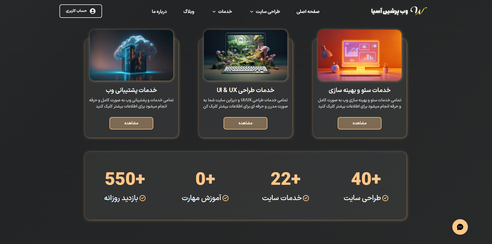
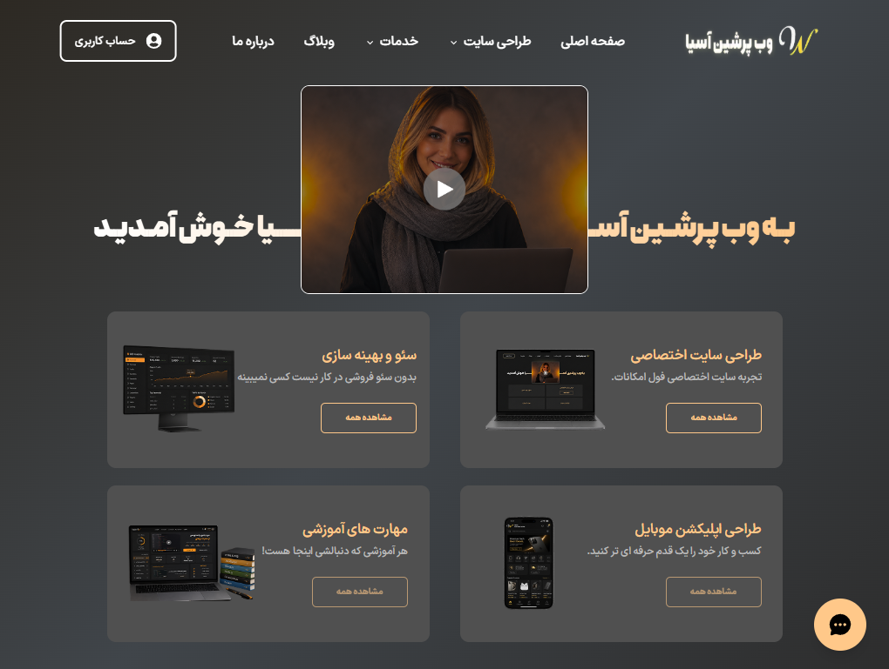
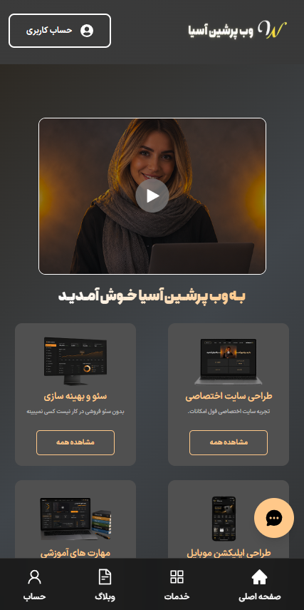

 

## ✨ معرفی پروژه

**وب پرشین آسیا** وب‌سایت رسمی و شرکتی مجموعه‌ی «وب پرشین آسیا» است؛ سایتی که هویت برند را معرفی می‌کند، خدمات را به‌صورت شفاف نمایش می‌دهد و مخاطب را به‌سادگی به مرحله‌ی تماس و سفارش می‌رساند.

این پروژه یک **سفارش واقعی و در حال استفاده** است و من در تیم، **طراحی رابط و تجربه‌ی کاربری (UI/UX)** و **توسعه‌ی فرانت‌اند** آن را بر عهده داشتم.

> 🔒 **درباره‌ی این ریپازیتوری:** سایت برای یک کارفرمای واقعی ساخته شده و سورس‌کد آن منتشر نمی‌شود. این صفحه فقط برای **معرفی پروژه، نمایش خروجی نهایی و توضیح کار انجام‌شده** است.

 

## 🔗 لینک‌ها

| | |
|---|---|
| 🌐 **سایت زنده** | [webpersianasia.com](https://webpersianasia.com/) |
| 👤 **نقش من** | طراح UI/UX و توسعه‌دهنده‌ی فرانت‌اند |
| 🗓️ **وضعیت** | منتشرشده و فعال |

 

## 🖼️ تصاویر پروژه

صفحه‌ی خدمات — دسکتاپ

  

<table>
  <tr>
    <td width="50%"></td>
    <td width="50%"></td>
  </tr>
  <tr>
    <td align="center">نسخه لپ تاپ</td>
    <td align="center">نسخه‌ی موبایل</td>
  </tr>
</table>

 

## 🚀 امکانات

- **صفحه‌ی اصلی برندمحور** با معرفی روشن مجموعه و دکمه‌های دعوت به اقدام (CTA)
- **معرفی خدمات** در بخش‌های مرتب و قابل اسکن
- **طراحی کاملاً ریسپانسیو** برای موبایل، تبلت و دسکتاپ
- **پشتیبانی کامل از فارسی و راست‌به‌چپ (RTL)**
- **تم تیره** با رنگ‌های گرم کهربایی و نارنجی، هماهنگ با هویت برند
- **سئوی فنی (SEO)**: متادیتا، ساختار عنوان‌ها و سرعت بارگذاری بهینه
- **انیمیشن‌ها و تعامل‌های ظریف** که تجربه را روان می‌کنند، بدون سنگین‌شدن صفحه
- **مسیرهای ارتباطی ساده** برای تماس و ثبت درخواست

> ✏️ _فهرست بالا را با امکانات دقیق سایت خودت تطبیق بده._

 

## 🎨 طراحی و هویت بصری

سایت روی یک تم تیره‌ی گرم طراحی شده تا حس حرفه‌ای و مدرن منتقل کند.

| رنگ | کد | کاربرد |
|---|---|---|
|  مشکی | `#0B0A09` | پس‌زمینه‌ی اصلی |
|  کهربایی روشن | `#FFC889` | رنگ اصلی برند، عنوان‌ها و دکمه‌ها |
|  نارنجی ملایم | `#FF9F43` | تأکید، آیکن‌ها و حالت hover |
|  نارنجی سوخته | `#F2711C` | جزئیات و المان‌های پرانرژی |
|  کرم روشن | `#F5EDE3` | متن اصلی روی زمینه‌ی تیره |

 

## 🧰 تکنولوژی‌ها

<table>
  <tr>
    <td align="center" width="120"> <b>Next.js</b></td>
    <td align="center" width="120"> <b>TypeScript</b></td>
    <td align="center" width="120"> <b>Tailwind CSS</b></td>
    <td align="center" width="120"> <b>Framer Motion</b></td>
    <td align="center" width="120"> <b>Prisma</b></td>
    <td align="center" width="120"> <b>PostgreSQL</b></td>
    <td align="center" width="120"> <b>SEO</b></td>
  </tr>
</table>

 

## 🧩 سهم من در پروژه

1. **طراحی UI/UX**: ساختار صفحه‌ها، سیستم رنگ و تایپوگرافی، طراحی ریسپانسیو
2. **توسعه‌ی فرانت‌اند** با Next.js (تخصص اصلی من)
3. **هماهنگی با بک‌اند** و اتصال رابط به داده‌ها
4. **سئو و ساختار محتوا**
5. **تست و رفع باگ** پیش از انتشار
6. **نگهداری و به‌روزرسانی** پس از راه‌اندازی

 

## 📬 ارتباط با من

اگر نمونه‌کار بیشتری لازم دارید یا پروژه‌ای در ذهن دارید:

- 📧 [arshamghaderi369@gmail.com](mailto:arshamghaderi369@gmail.com)
- 🌐 دیگر نمونه‌کار: [کالکشن روائی](https://github.com/YOUR_USERNAME/ravaeiclothes-showcase)

 

© تمام حقوق این پروژه متعلق به کارفرمای آن است. سورس‌کد منتشر نشده است.

